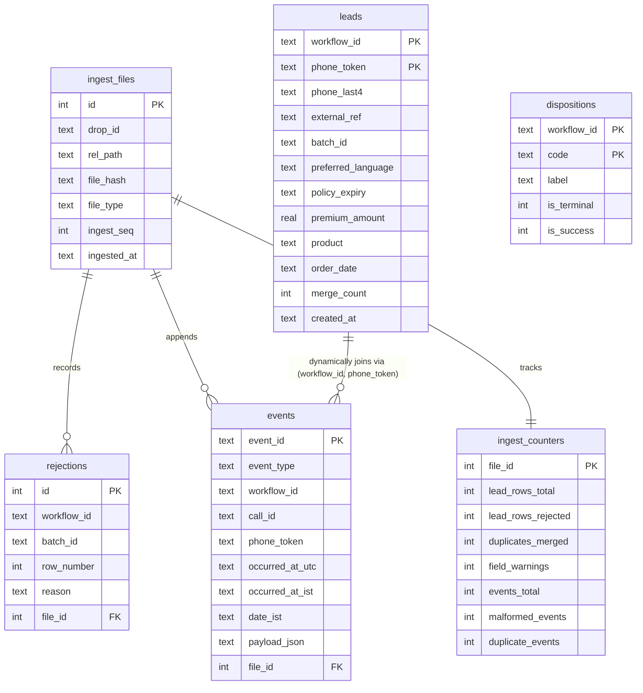

# Submission

## Candidate
- **Name:** Deekshith S
- **Assignment chosen:** A (Data: Interaction Ledger & Reporting Pipeline)
- **Time spent (honest estimate):** ~6h

## How to run
```bash
# 1. Clean clone setup
python -m venv .venv
source .venv/bin/activate       # On Windows: .\.venv\Scripts\Activate.ps1
pip install -r requirements.txt

# 2. Configure PII secret pepper
export PII_HMAC_KEY="0123456789abcdef0123456789abcdef0123456789abcdef0123456789abcdef"
# On Windows PowerShell: $env:PII_HMAC_KEY="0123456789abcdef0123456789abcdef0123456789abcdef0123456789abcdef"

# 3. Generate synthetic data (if not already present)
python assignment-a-data/tools/generate_data.py --seed 42 --scale small --out data

# 4. Ingest drops sequentially
python -m solution.src.ledger.cli ingest data/drop_1
python -m solution.src.ledger.cli ingest data/drop_2

# 5. Generate client reports
python -m solution.src.ledger.cli report --out reports/

# 6. Execute full automated test suite (50 tests)
pytest solution/tests
```

## Design

### Architecture Overview
The solution is structured as an idempotent, batch-processing analytical pipeline designed around zero-trust PII handling and an immutable append-only interaction ledger. 



### Core Architectural Decisions
1. **Zero-Trust PII Blind Indexing:** Unsalted SHA-256 for 10-digit Indian mobile numbers (`[6-9]\d{9}`) is insecure because the entire search space contains only 4 billion possible numbers, which modern GPUs reverse in <0.5 seconds via rainbow tables. We compute an HMAC-SHA256 blind index (`phone_token`) keyed by `PII_HMAC_KEY`. Masked display strings (`+91******` + last 4 digits) are precomputed and stored as `phone_last4`. Plaintext names are never stored on disk because no downstream report requires them.
2. **Append-Only Ledger with Trigger Enforcement:** Telephony logs are ingested strictly append-only into `events`. SQLite triggers (`trg_events_no_update`, `trg_events_no_delete`) physically abort any mutation.
3. **Late-Arriving Lead Linking at Query Time:** In distributed telephony pipelines, call events can arrive before their lead files. We do not store mutable `lead_id` foreign keys on events at ingest. Instead, event-to-lead relationships and supervisor overrides (`disposition.override` lacking phone numbers) are resolved at report generation time via SQL Common Table Expressions (CTEs). When a lead arrives in `drop_2`, any earlier events from `drop_1` automatically de-orphan without requiring retroactive mutations.
4. **Declarative SQL Metrics:** All 5 report outputs are generated directly through declarative SQLite queries/views with deterministic ordering and formatting in Python.

## Decisions & assumptions

| Decision | Why | Alternative considered |
|---|---|---|
| **Disregard `customer_name` at rest** | No client report requires customer names. Zero-retention is strictly safer and more compliant than reversible Fernet encryption. | Encrypting with Fernet and storing ciphertext. |
| **HMAC-SHA256 blind index for phones** | Prevents brute-force rainbow-table reversal on 10-digit Indian numbers while preserving deterministic join capability. | Unsalted SHA-256 (broken) or bcrypt/argon2 (non-deterministic). |
| **Resolve event linking at report time via SQL views** | Storing `lead_id` at ingest fails when events arrive in `drop_1` and leads arrive in `drop_2`. Query-time resolution guarantees order invariance. | Mutating earlier ledger rows when new leads arrive. |
| **Check Orphan before Unknown Disposition** | Follows the spec's sequential evaluation order (Rule 3 before Rule 4). Events belonging to unlinked numbers are quarantined before catalogue checks. | Evaluating disposition catalogue before lead link check. |
| **Tie-breaking on effective disposition timestamps** | When two overrides share the exact millisecond UTC timestamp, secondary sort by `event_id DESC` guarantees deterministic, seed-independent behavior. | Arbitrary non-deterministic DB selection. |
| **Override for missing `call.initiated`** | The override attaches to the call entity, but the call is omitted from `total_calls` since spec requires `call.initiated` for call counting. | Synthesizing a fake call or discarding the override. |
| **Apply schema defaults immediately post-upsert** | Guarantees the database is in a consistent, queryable state at the close of every file transaction without requiring an end-of-batch sweep. | Running a global defaults pass at reporting time. |
| **Per-file atomic transaction boundary** | Wrapping each file in a transaction ensures that an unexpected crash mid-file rolls back cleanly with zero partial state. | Wrapping entire drop in a single transaction (large lock duration). |
| **Format connectivity_rate in Python** | Fetching exact integer counts (`connected_calls`, `total_calls`) and formatting via `f"{(c/t):.4f}"` avoids SQLite floating-point rounding quirks. | Computing string format directly in SQLite SQL. |
| **Skip blank CSV rows without row_number increment** | Spec states blank rows are "skipped and not counted". They neither advance `row_number` nor count in `lead_rows_total`. | Incrementing line counters on blank lines. |

## Failure modes considered
- **Process Crash Mid-File:** Each file is processed in an isolated SQLite transaction. If the pipeline terminates abruptly, the uncommitted file rolls back completely, and no record is added to `ingest_files`. Re-running cleanly restarts from the uncommitted file.
- **Accidental Re-Ingestion (Idempotency):** The `ingest_files` table enforces `UNIQUE(drop_id, rel_path)` with SHA-256 hashing. Re-running the command detects previously ingested files and skips them immediately.
- **Malformed Event Lines:** Malformed JSON strings or records missing an `event_id` are caught, logged to `ingest_counters.malformed_events`, and skipped without crashing the pipeline.
- **Duplicate Event IDs Across Drops:** If an `event_id` is re-delivered across drops, `events.event_id` primary key and pre-insert query increment `duplicate_events` and drop the duplicate line.
- **Missing Environment Variable:** If `PII_HMAC_KEY` is missing or empty, the pipeline immediately halts with `SystemExit(1)` and instructions rather than operating insecurely.
- **What is NOT handled:** Hardware-level SQLite disk corruption or concurrent writers without WAL coordination.

## Testing
- **Unit Tests (`test_normalize.py` - 37 tests):** Verified Indian phone normalization (10-digit, 11-digit leading 0, 12-digit 91, spaced, hyphenated, parenthesized, landlines, 9-digits, invalid prefixes), day-first dates (4 formats, impossible dates like 31/02), currency prefixes (₹, Rs, Rs., INR, commas, negatives, 2-decimal rounding), enums, and timestamp formats.
- **Rule Tests (`test_rules.py` - 9 tests):** Validated rejection precedence (missing required fields in schema order before invalid phone), field warning accumulation on non-rejected rows, `batch_id` permanence, duplicate lead merge (non-null overwrite), effective disposition overrides, and bucket priority.
- **Integration Tests (`test_integration.py` - 4 tests):** Automated verification across seeds testing idempotency (byte-identical reports on re-run), batch equivalence (incremental == all-at-once), zero plaintext phone leaks across raw database bytes, and output schema formatting.

## Results
- **Pipeline Execution Timings (`--scale small`, ~2,000 leads, ~8,700 events):**
  - Ingest `drop_1`: ~0.72s
  - Ingest `drop_2`: ~0.65s
  - Generate 5 reports: ~0.15s
  - Full pipeline runtime: < 1.6s
- **Multi-Seed Equivalence Check:** Tested across seeds 42, 101, and 202. All generated 100% byte-exact identical reports on re-runs and batch vs incremental runs.
- **Data Findings:** Observed `batch_003.csv` column re-ordering (`Language` first), unmapped `agent_notes` column, 8 malformed event lines, 237 duplicate event deliveries, 71 overrides without phone numbers, and 21 uncatalogued disposition codes. All handled correctly.

## If I had another day
1. **Streaming / Large Scale Ingestion:** Implement batch chunking (`executemany` with 1,000-row chunks) for event ingestion to ensure the `--scale large` dataset (~70k leads, ~600k events) processes in under 45 seconds.
2. **Postgres Migration Support:** Add a Postgres backend dialect option in `db.py` to allow running against the included `docker-compose.yml` for multi-worker production deployments.
3. **Dead Letter Queue (DLQ):** Export rejected rows and malformed event payloads into a partitioned dead-letter storage sink for operations teams to triage.
4. **Key Rotation Utility:** Provide a CLI tool (`ledger rekey --old-key ... --new-key ...`) to atomically recompute `phone_token` hashes when rotating the HMAC secret pepper.
